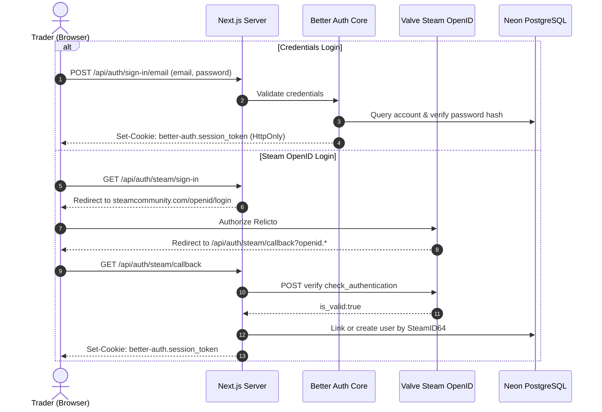
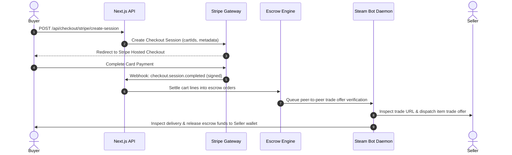
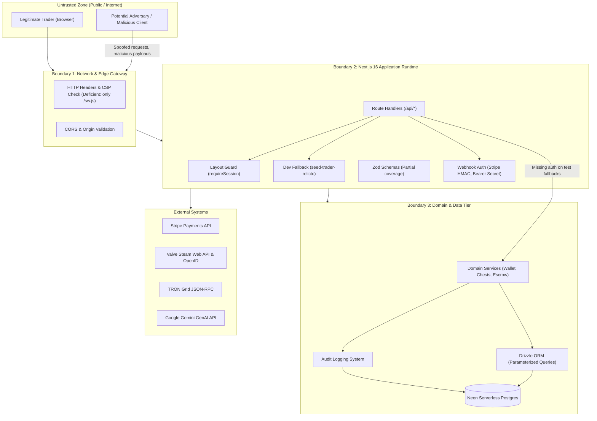

# Architecture & Threat Model Baseline

**Application:** Relicto  
**Audit Phase:** Phase 0 — Discovery and Baseline  
**Date:** November 2026  

---

## 1. Technical Stack & Component Topology

| Layer | Technologies & Versions | Role / Responsibilities |
| :--- | :--- | :--- |
| **Runtime** | Node.js v22 (`.nvmrc`), TypeScript 5 | Server-side execution environment |
| **Framework** | Next.js 16.3.5 (App Router), React 19.2.8 | Server Components, Client Hydration, Route Handlers |
| **Styling & UI** | Tailwind CSS v4, Radix UI, Base UI, Lucide Icons | Responsive UI, atomic styling tokens |
| **Database & ORM** | Neon PostgreSQL, Drizzle ORM 0.45.2, `pg` 8.23.0 | Relational data persistence, migration runner, pool management |
| **Authentication** | Better Auth 1.7.5, `@better-auth/infra`, Steam OpenID 2.0 | Credentials auth, session cookies, 2FA, Steam login |
| **Payment Gateways** | Stripe SDK 23.0.0, TRON Grid / Web3 | Credit card sessions, webhooks, USDT TRC20 verification |
| **AI Copilot** | `@google/genai` 2.30.0 | Sentinel market intelligence chat agent |
| **Notifications** | `web-push` 3.6.7 (VAPID) | Background push notification delivery |

---

## 2. Architectural Layers

### 2.1 Presentation & Client Layer (`src/modules/*`, `src/components/*`)
- Composed of React 19 Client and Server Components.
- User state is managed via React hooks (`nuqs` for URL search params, local state for unboxing animations).
- Design system follows strict token guidelines from `CLAUDE.md`.
- No sensitive keys or secrets exist in the client bundles; only `NEXT_PUBLIC_*` variables are exposed.

### 2.2 Server Routing & Handlers (`src/app/api/*`, `src/app/(lootora)/*`)
- Next.js 16 App Router handles both page rendering (RSC) and HTTP endpoints (Route Handlers).
- **Session Resolution:** Handled through `getSession()`, `getUserId()`, and `requireUserId()` in `src/modules/relicto/data/get-session.ts`.
- **Note on Middleware:** Next.js `middleware.ts` or `proxy.ts` is **not present** in the codebase. Route protection for account pages is enforced at the layout level (`src/app/(lootora)/(account)/layout.tsx`) using React Server Components.

### 2.3 Domain Services & Repositories (`src/server/modules/*`)
- Pure server-side logic tagged with `import "server-only"`.
- Module design pattern:
  - `*.service.ts`: High-level business logic, orchestrations, and validations.
  - `*.repository.ts`: Drizzle ORM queries and database mutations.
  - `*.schema.ts`: Zod schema definitions for input validation.
  - `*.presenter.ts`: Transformation of database rows into presentation models.

### 2.4 Persistence Layer (`src/lib/db/*`)
- Drizzle ORM with Neon serverless Postgres driver.
- Configured with connection pool recycling (`idleTimeoutMillis: 10_000`, `connectionTimeoutMillis: 30_000`) and `@vercel/functions` `attachDatabasePool`.
- Migrations located in `drizzle/` directory.

---

## 3. Core Data & Authentication Flows

### 3.1 Authentication & Session Lifecycle

### 3.2 Escrow & Order Settlement Flow

---

## 4. Trust Boundaries & Attack Surfaces

---

## 5. Architectural Threat Observations

1. **Absence of Centralized Next.js Middleware:**
   - Routes rely on layout-level checks or individual route handler checks. An API route that fails to explicitly check session cookies is completely unauthenticated by default.
2. **Development-Mode Identity Fallback:**
   - `getUserId()` and `getSession()` automatically fall back to `"seed-trader-relicto"` when `NODE_ENV === "development"`. If a developer or staging server is run in development mode, any anonymous request acquires authenticated trader privileges.
3. **Financial Gateway Fallbacks:**
   - When external keys (`STRIPE_SECRET_KEY`) are missing, checkout and wallet deposit routes execute mock settlements that directly create orders or credit liquid balance.
4. **Decentralized State for Provably Fair Chests:**
   - Chest unboxings and coin purchases currently operate with in-memory / JSON runtime states (`.chests-runtime.json`, `.user-coins-runtime.json`) rather than strict database transactions, which poses concurrency and race-condition risks.

